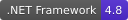
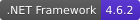

# Trivial Toolkit for Apps

## [Trivial.WindowsKit](./Common)

- Controls: A set of useful controls including tiles, collections and tabbed web view.
- Local web app: A way to launch H5 app locally with native capability and auto-update.
- Utilities: Helper class of visual element, dependency object and JSON HTTP client.

## [Trivial.Console](./Console)

The rich UX CLI controls.

- [Console utilities and components](./docs/console)

## [Trivial.Web](./Web)

The useful utilities for ASP.NET application.

- [Controller extensions for ASP.NET Core](./docs/web/controller)
